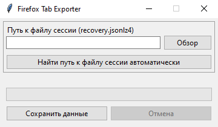

# Firefox Tab Exporter


Утилита с открытым исходным кодом для экспорта открытых вкладок Firefox. Используется файл сессии `recovery.jsonlz4` или `sessionstore.jsonlz4`. В программе реализован автоматический поиск, рекомендуется использовать его



## Возможности

- Автоматический поиск файла сессии Firefox
- Прогресс-бар (полезен на маломощных ПК и при сохранении больших объемов данных)
- Сохранение открытых вкладок (название и ссылка) в TXT-файл
- Возможность выбора пути для сохранения вкладок
- Отмена экспорта данных

## Системные требования

- 🖥️ Windows 10<br/>
- 🐍 Python 3.9+

> [!WARNING]
> Linux и macOS не поддерживаются

## Установка и запуск

Клонируйте репозиторий

```bash
git clone https://github.com/lezhebokin/firefox-tab-exporter.git
```

Перейдите в директорию проекта

```bash
cd firefox-tab-exporter
```

Установите внешние зависимости

```bash
pip install -r requirements.txt
```

Запустите программу

```bash
python main.py
```

## Использование

1. Выполните автоматический поиск файла сессии или найдите его вручную
2. Нажмите «Сохранить данные»

> [!WARNING]
> Перед экспортом вкладок закройте Firefox. Иначе данные могут быть устаревшими

## Сборка исполняемого файла

Создайте виртуальное окружение

```bash
python -m venv .venv
```

Активируйте его

```bash
.venv\Scripts\activate
```

Установите модуль PyInstaller

```bash
pip install pyinstaller
```

Выполните в корне проекта

```bash
pyinstaller --clean --noconsole --onedir --name firefox-tab-exporter --contents-directory library main.py
```

После сборки в директории `dist\firefox-tab-exporter` появятся исполняемый файл и все необходимые зависимости

## Лицензия

Проект распространяется под лицензией [BSD-3-Clause](https://github.com/lezhebokin/firefox-tab-exporter/blob/main/LICENSE)
